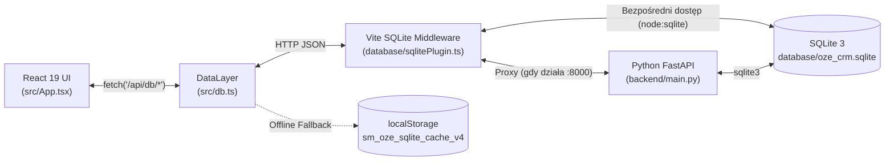
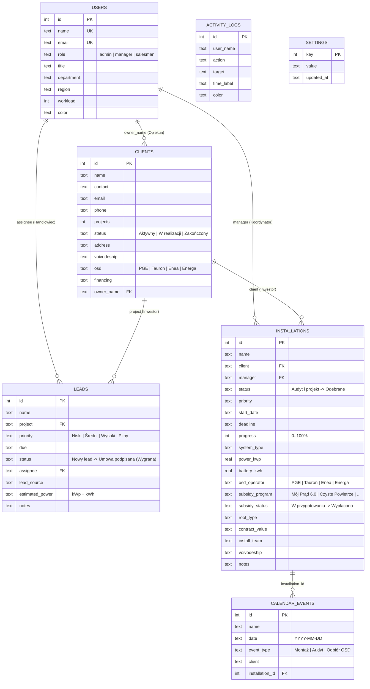

# SM-OZE Polska — System CRM & FSM (Identyfikacja wizualna SM-Project)

Korporacyjny system klasy **CRM** (Customer Relationship Management) oraz **FSM** (Field Service Management), zaprojektowany dla polskiego rynku odnawialnych źródeł energii (**OZE**: fotowoltaika **PV**, magazyny energii **BESS**, pompy ciepła oraz domy pasywne). Styl wizualny i paleta kolorystyczna w pełni odwzorowują firmową identyfikację wizualną **SM-Project (`sm-project.pl`)**.

---

## 1. Architektura i struktura projektu

```text
f:\mvp crm system v1\
├── index.html                  # Powłoka HTML aplikacji
├── package.json                # Skrypty uruchomieniowe (Vite + FastAPI) oraz zależności
├── vite.config.ts              # Konfiguracja Vite + wbudowany middleware SQLite
├── backend/
│   ├── main.py                 # Serwer REST API w Pythonie (FastAPI + SQLite3 + dokumentacja Swagger /docs)
│   └── requirements.txt        # Zależności backendu Python (fastapi, uvicorn, pydantic)
├── database/
│   ├── schema.sql              # Relacyjny schemat DDL bazy danych SQLite (7 tabel + indeksy)
│   ├── oze_crm.sqlite          # Plik relacyjnej bazy danych SQLite 3
│   └── sqlitePlugin.ts         # Serwerowy plugin Vite do obsługi SQLite i proxy do FastAPI
└── src/
    ├── main.tsx                # Punkt wejścia React 19
    ├── App.tsx                 # Główny komponent CRM/FSM, nawigacja modułów, RBAC i okna modalne
    ├── ui.tsx                  # Komponenty UI wielokrotnego użytku (Icon, Button, Badge, Avatar, Progress, Section)
    ├── db.ts                   # Kliencki DataLayer (klient REST do /api/db/* + pamięć podręczna offline)
    ├── data.ts                 # Typy TypeScript oraz startowe dane demonstracyjne (seed) dla bazy danych
    └── index.css               # Globalne style Tailwind CSS v4 + identyfikacja SM-Project (#137684, #FBBF3A, #252629)
```

---

## 2. Schemat przepływu danych (Data Flow)

System wykorzystuje **trójwarstwową, odporną na awarie architekturę przechowywania danych**:



1. **Python FastAPI (`backend/main.py` na porcie `8000`)** — główny serwer REST API z walidacją modeli Pydantic oraz interaktywną dokumentacją Swagger UI (`/docs`).
2. **Vite SQLite Middleware (`database/sqlitePlugin.ts`)** — warstwa wbudowana bezpośrednio w serwer deweloperski Vite. Jeśli serwer FastAPI jest uruchomiony, plugin automatycznie przekazuje do niego zapytania; jeśli FastAPI jest zatrzymany, plugin samodzielnie wykonuje zapytania SQL bezpośrednio na pliku `database/oze_crm.sqlite` za pomocą wbudowanego silnika `node:sqlite`.
3. **Offline Cache (`src/db.ts`)** — synchronizuje migawki bazy danych w `localStorage` jako awaryjne źródło danych w środowisku czysto statycznym.

---

## 3. Schemat relacyjnej bazy danych SQLite (`database/schema.sql`)

Baza danych `database/oze_crm.sqlite` składa się z **7 powiązanych tabel**:



---

## 4. Logika biznesowa i kluczowe procesy działania

### 4.1. Kontrola dostępu oparta na rolach (RBAC — Role-Based Access Control)
W górnym pasku nawigacyjnym oraz w panelu bocznym można błyskawicznie przełączać się pomiędzy 3 rolami systemowymi w celu weryfikacji uprawnień oraz izolacji danych (zgodność z RODO):

| Rola | Dostępne moduły | Uprawnienia i ograniczenia w logice biznesowej |
| :--- | :--- | :--- |
| **Admin (Dyrektor)** | Wszystkie **9 modułów**, w tym `Ustawienia` | Pełny dostęp CRUD do wszystkich tabel, zarządzanie rolami pracowników (`users`), konfiguracja auto-konwersji (`settings`), reset oraz eksport bazy SQLite (JSON/CSV). |
| **Manager (Koordynator)** | **8 modułów** (bez `Ustawienia`) | Zarządzanie procesem montażowym (`Realizacje OZE`), przypisywanie ekip monterskich, zmiana etapów technicznych inwestycji oraz zatwierdzanie statusów wniosków **OSD / NFOŚiGW**. |
| **Salesman (Handlowiec)** | **5 modułów** (`Przegląd`, `Realizacje OZE`, `Leady i Sprzedaż`, `Klienci i Obiekty`, `Grafik Montaży`) | **Izolacja danych RODO:** widzi wyłącznie własnych klientów (`owner_name`), własne leady (`assignee`) oraz realizacje montażowe przypisane do jego klientów. Nie może zmieniać technicznych etapów montażu ani statusów dotacji, ale może **podpisywać umowy na leadach**. |

---

### 4.2. Automatyczna konwersja leada w realizację montażową (Sales → Operations Automation)
Kluczowy proces automatyzacji łączący dział handlowy z działem technicznym:
1. Handlowiec (**Salesman**) prowadzi klienta przez lejek sprzedaży w module **`Leady i Sprzedaż`**:
   - `Nowy lead` → `Audyt / W toku` → `Oferta / Weryfikacja` → **`Umowa podpisana (Wygrana)`**.
2. W momencie zmiany statusu leada na **`Umowa podpisana (Wygrana)`** (poprzez listę rozwijaną, przeciągnięcie karty w widoku Kanban lub zaznaczenie pola wyboru), gdy w ustawieniach aktywna jest opcja `autoConvertLead`:
   - **Backend automatycznie odczytuje** dobraną moc z leada (np. `9.8 kWp + 10 kWh`).
   - **Tworzy lub aktualizuje kartę inwestora** w tabeli `clients` (zwiększa licznik obiektów `projects + 1` oraz zmienia status klienta na `W realizacji`).
   - **Automatycznie rejestruje nową inwestycję OZE** w tabeli `installations` (`Realizacje OZE`) na etapie `Audyt i projekt` (postęp `20%`), przypisuje operatora sieci OSD (`PGE`, `Tauron`, `Enea`, `Energa`), program dotacyjny (`Mój Prąd 6.0` / `Czyste Powietrze`) oraz wylicza wartość umowy brutto w PLN.
   - **Planuje wyjazd na audyt techniczny** w tabeli `calendar_events` (`Grafik Montaży`).
   - **Zapisuje ślad rewizyjny** w dzienniku transakcji `activity_logs` (Audit Log).

---

### 4.3. Operacyjny lejek realizacji OZE (FSM Pipeline)
Po przekazaniu inwestycji do modułu **`Realizacje OZE`**, koordynator (**Manager** lub **Admin**) zarządza etapami technicznymi, a system automatycznie aktualizuje wskaźnik postępu prac (`progress`):
- `Audyt i projekt` → **20%**
- `Kompletacja sprzętu` → **45%**
- `Montaż w toku` → **70%**
- `Zgłoszenie OSD / Dotacja` → **90%**
- `Odebrane` → **100%**

---

### 4.4. Centrum Dotacji i Operatorów Sieci (`Dotacje i OSD`)
Dedykowany moduł do obsługi formalno-prawnej przyłączeń i dofinansowań w Polsce:
- **Operatorzy Systemu Dystrybucyjnego (OSD):** `PGE`, `Tauron`, `Enea`, `Energa` (zgłoszenie mikroinstalacji i wymiana licznika na dwukierunkowy).
- **Programy dotacyjne (NFOŚiGW / WFOŚiGW):** `Mój Prąd 6.0`, `Czyste Powietrze`, `Ciepłe Mieszkanie`, `Brak (B2B)`.
- **Etapy procesowania wniosku:** `W przygotowaniu` → `Złożony w NFOŚiGW` → `Weryfikacja OSD` → `Wypłacono`.

---

### 4.5. Wbudowany kalkulator doboru mocy OZE (`/api/db/calculate-oze`)
W oknie tworzenia lub edycji leada oraz realizacji dostępny jest kalkulator oparty na miesięcznym rachunku za prąd (`Rachunek za prąd PLN/mies.`):
- Na podstawie kwoty rachunku w PLN algorytm oblicza roczne zapotrzebowanie na energię (kWh), rekomenduje moc instalacji fotowoltaicznej (**kWp**) oraz pojemność magazynu energii (**kWh**), szacuje koszt inwestycji brutto, kwotę dotacji **Mój Prąd 6.0** (do `23 000 PLN`) oraz przewidywany czas zwrotu w latach.

---

## 5. Identyfikacja wizualna SM-Project (`src/index.css`)

System projektowy został zbudowany w oparciu o oficjalną paletę barw witryny **https://sm-project.pl/kontakt/**:
- **Kolor główny (`--sm-primary`):** `#137684` (głęboki morski / turkusowy) — stosowany w panelu bocznym, nagłówkach tabel, przyciskach drugorzędnych i kartach KPI.
- **Ciemny odcień (`--sm-primary-dark`):** `#1B5E6D` — wykorzystywany w gradientach banerów nagłówkowych oraz okien modalnych.
- **Słoneczny kolor akcentowy (`--sm-secondary`):** `#FBBF3A` (złocisto-żółty) — stosowany we wszystkich głównych przyciskach CTA (`.btn.primary`), aktywnych zakładkach, odznakach i wskaźnikach.
- **Kontrastowy tekst (`--sm-text`):** `#252629` (antracytowy).
- **Typografia:** geometryczny krój bezszeryfowy `Montserrat`.

---

## 6. Uruchomienie projektu

1. **Uruchomienie frontendu wraz z wbudowanym serwerem SQLite (Vite):**
   ```bash
   pnpm dev
   ```
2. **Uruchomienie backendu Python FastAPI (opcjonalnie, dla pełnego serwera uvicorn oraz dokumentacji Swagger UI):**
   ```bash
   pnpm backend
   ```
   Po uruchomieniu FastAPI interaktywna dokumentacja OpenAPI / Swagger jest dostępna pod adresem: `http://127.0.0.1:8000/docs`.
